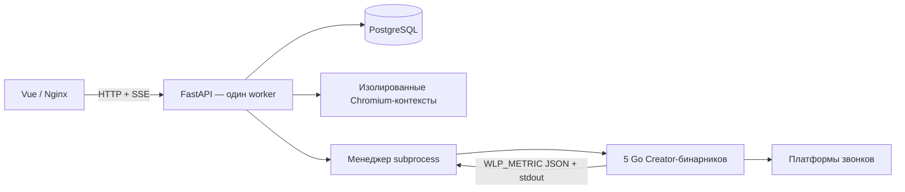

# prnl +

Локальная админ-панель для [whitelist-bypass](https://github.com/kulikov0/whitelist-bypass): Vue 3 / TypeScript, Python / FastAPI, PostgreSQL 17 и Docker Compose.

## Благодарности и сторонние компоненты

Creator, relay и Desktop Creator в этом проекте основаны на открытом проекте [whitelist-bypass](https://github.com/kulikov0/whitelist-bypass) автора [kulikov0](https://github.com/kulikov0). При сборке Docker проект получает исходный код upstream на закреплённом коммите, применяет интеграционные изменения из `integration/` и собирает необходимые компоненты. Авторство исходного проекта и его кода принадлежит автору upstream; этот проект не заявляет на них исключительных прав. Лицензия upstream — MIT; её текст включается в backend-образ вместе с компонентами Creator.

## Запуск

Скопируй `.env.example` в `.env` рядом с `compose.yaml` и задай собственные значения для `POSTGRES_PASSWORD`, `ADMIN_PASSWORD` и `ENCRYPTION_KEY`. Не используй примеры или пароли из чатов. `ENCRYPTION_KEY` должен быть постоянным: он нужен для расшифровки cookies, ссылок и настроек после восстановления базы. Можно создать его командой `python3 -c 'from cryptography.fernet import Fernet; print(Fernet.generate_key().decode())'`.

`.env` и локальные секреты исключены из Git и Docker build context. Не добавляй в репозиторий резервные копии `.env`, cookies/экспорты Creator, логи, runtime-данные или приватные сертификаты. На production передавай `.env` защищённым способом:

```dotenv
PANEL_BIND_IP=0.0.0.0
PANEL_HTTP_PORT=8080
PANEL_HTTPS_PORT=443
PANEL_CERT_HOST=ПУБЛИЧНЫЙ_IP_СЕРВЕРА
PUBLIC_ORIGIN=https://ПУБЛИЧНЫЙ_IP_СЕРВЕРА
ADMIN_USERNAME=твой_логин
ADMIN_PASSWORD=длинный_случайный_пароль
```

Оставь существующие `POSTGRES_PASSWORD` и `ENCRYPTION_KEY` без изменений. Если это новая установка, задай им уникальные случайные значения. `ENCRYPTION_KEY` сохрани отдельно: он нужен для расшифровки cookies, ссылок и настроек после восстановления базы.

Для доступа только с самого сервера укажи `PANEL_BIND_IP=127.0.0.1` и `PUBLIC_ORIGIN=https://localhost:8080`. Для внешнего доступа оставь `0.0.0.0`, укажи реальный IP в `PANEL_CERT_HOST` и `PUBLIC_ORIGIN`, затем открой `PANEL_HTTPS_PORT` и `PANEL_HTTP_PORT` в firewall. `PANEL_HTTP_PORT` обслуживает HTTPS и перенаправляет обычный HTTP на HTTPS; второй порт — внешний HTTPS вход.

По желанию задай `XRAY_VLESS_URI` и `XRAY_ENABLED=true`, чтобы Xray поднял VPN-маршрут при первом старте. Для автоподключения Matrix задай `MATRIX_HOMESERVER`, `MATRIX_USERNAME` и `MATRIX_PASSWORD`. После успешного первого входа данные Matrix и VPN сохраняются в зашифрованном runtime. Если параметры интеграций не указаны, подключи их после запуска в настройках панели.

Запусти проект на сервере одной командой:

```sh
docker compose up -d
```

`scripts/configure.py` можно использовать как необязательный помощник для создания или обновления `.env`; он не нужен, если файл уже заполнен.

После первого входа панель покажет напоминание сменить пароль. Сохраняй резервную копию `.env` вместе с базой; не коммить этот файл.

Входная ссылка со случайным секретным путём появится в **Настройки → Панель**. При первом старте создаётся локальный центр подписи; серверный сертификат обновляется автоматически. Сверь SHA-256 отпечаток, затем установи скачанный **ROOT CA** в доверенные сертификаты своего устройства. Не удаляй Docker volume `panel_tls`: в нём лежат ключ центра подписи и секретный путь.

Для внешнего reverse proxy настрой `PUBLIC_ORIGIN`, оставь `COOKIE_SECURE=true` и не публикуй напрямую порты `panel-tls`. Не размещай `.env` в Git. При резервном копировании PostgreSQL сохраняй также `ENCRYPTION_KEY`: без него cookies, ссылки и интеграции нельзя расшифровать.

## Первый аккаунт и звонок

1. В разделе **Аккаунты** добавьте VK, Телемост, WB Stream, DION или Битрикс24. Для Битрикс24 укажите адрес портала.
2. Нажмите **Настроить → Войти через браузер**. Это отдельный Chromium-контекст на сервере, а не iframe сайта платформы.
3. Кликните нужное поле на снимке браузера. Введите логин, пароль или код в поле под снимком и нажмите «Ввести». Для навигации доступны Tab, Enter, Backspace, Ctrl+A и прокрутка. Можно пройти визуальную CAPTCHA. Новые вкладки OAuth показываются автоматически.
4. После завершения входа нажмите **Я вошёл — сохранить cookies**. Для WB Stream перехватывается bearer-токен из запросов к `stream.wb.ru`, как в официальном Creator. Для Bitrix сохраняется привязка cookie к хосту. Проверяется наличие ожидаемой auth-cookie; это ещё не проверка её действительности.
5. В **Настроить** запустите настоящий upstream **Desktop Creator** на сервере. В его окне войдите в Telemost и нажмите **Перенести cookies в аккаунт**. Панель берёт `cookies-yandex.json` из штатного экспорта Desktop Creator, сохраняет пары `name/value` зашифрованными и при запуске передаёт их upstream `headless-telemost-creator`. Отдельно можно скачать штатные JSON и ZIP. Экран приложения передаётся JPEG-кадрами примерно раз в 1,2 секунды; доступны клики, клавиши и ввод текста. Первый кадр появляется после загрузки окна. Для DION и Битрикс24 можно также задать автоматический повторный вход. VK и WB Stream в headless Creator не поддерживают повторный вход по паролю.
6. Создайте сессию, выберите аккаунт и профиль ресурсов. Пустое поле комнаты создаёт новый звонок; существующая ссылка присоединяет Creator к комнате.
7. Запустите Creator, скопируйте ссылку после создания звонка, передайте её **одному** Joiner.
8. Значок журнала в строке сессии открывает её события с фильтрами по времени и уровню сообщений. Более ранние записи загружаются кнопкой внизу. Значок QR-кода открывает отдельное окно с кодом, ссылкой и кнопками копирования ссылки и QR-кода как PNG.

Альтернативно можно импортировать `cookies.zip` или JSON из официального Creator. Для DION и Bitrix можно импортировать `{ "email": "...", "password": "...", "cookies": [] }`; для Bitrix портал задаётся в аккаунте панели. Это позволяет upstream повторно войти после истечения cookies. Пароли, введённые в удалённом браузере, панель отдельно не сохраняет. Импорт проверяет формат и наличие `Session_id` для Telemost; действительность проверяет платформа при запуске.

## Что означают статусы

- **Запускается** — процесс создан, ссылка на комнату ещё не получена.
- **Работает** — upstream записал ссылку. Это не доказывает подключение Joiner или доступность сайта через туннель.
- **Активность подтверждена** — за последние 15 секунд Creator получил декодированное сообщение прикладного протокола туннеля, а телеметрия свежая (не старше 6 секунд).
- **Не подтверждён** — нет свежих сообщений. Спящий Joiner может оставаться подключённым; отсутствие активности не считается доказательством разрыва.
- **RX / TX** — байты полезной нагрузки на границе relay с точки зрения Creator: RX от Joiner, TX к Joiner. Служебные сообщения и WebRTC overhead исключены; TX означает передачу в транспорт, не подтверждение доставки сайтом. UDP payload включает адресный префикс протокола.
- **TCP + UDP** — записи текущего RelayBridge. В legacy VK DC учитываются TCP-записи, UDP не учитывается. Это количество соединений, а не пользователей.
- **Ошибка** — Creator завершился с ненулевым кодом. **Прервана** — backend перезапускался; сессию нужно запустить вручную. Код 0 без запроса остановки отображается как «Завершена».

SSE передаёт снимок каждые 2 секунды. При потере потока панель показывает сообщение об устаревании данных. Открытый журнал сессии обновляется каждые 2,5 секунды; записи загружаются страницами по 300, хранятся последние 2000 на сессию.

## Архитектура и данные



Cookies, сохранённые ссылки и введённые ссылки комнат зашифрованы Fernet в PostgreSQL. Во время работы Creator его cookies находятся в файле 0600 в закрытом каталоге runtime, поскольку upstream требует путь к файлу. Обновлённые cookies синхронизируются обратно в БД раз в секунду и при остановке. После аварийного завершения backend восстанавливает обновлённые cookies из runtime и удаляет временные файлы при старте.

Один аккаунт используется максимум одним процессом одновременно, чтобы не разрушать цепочки refresh-токенов DION. Во время работы Creator изменение cookies и открытие входа заблокированы. Браузерные контексты закрываются после сохранения, явного закрытия или 15 минут без обращений. Доступ браузера к приватным IP блокируется на уровне маршрутизации запросов; не предоставляйте панель недоверенным пользователям.

Пароли не возвращаются через API. Cookies доступны администратору через явное скачивание экспорта; эти ответы запрещают кеширование. Вывод процессов перед записью в журнал проходит редактирование известных секретов, URL, auth-сообщений и token/password-полей. Это не заменяет аудит вывода новых upstream-версий. Панель не выдаёт shell-команды пользователю и не монтирует Docker socket. Creator работает внутри backend-контейнера от непривилегированного пользователя; Docker init собирает дочерние процессы.

## Проверки

```sh
uv venv .venv
uv pip install --python .venv/bin/python -r backend/requirements.txt
PYTHONPATH=backend .venv/bin/pytest backend/tests -q
cd frontend
npm ci
npm run build
```

Тест subprocess использует управляемый тестовый executable: проверяет запуск/остановку, разбор телеметрии, сохранение обновлённых cookies и скрытие секретов. Он не подтверждает реальный обход блокировок. Для сквозной проверки нужна ваша авторизация и отдельный Joiner в ограниченной сети.

## Остановка

```sh
docker compose down
```

Тома PostgreSQL и runtime сохраняются. Не используйте `down -v`, если хотите сохранить аккаунты и журнал. У проекта нет глобальной установки, hooks или изменений настроек Codex.

## Текущие границы

- Один администратор, один backend worker и один сервер Creator. Горизонтальное масштабирование и роли пользователей пока не реализованы.
- Удалённый браузер передаёт снимки с интервалом 1,5 секунды; перетаскивание CAPTCHA, файлы, аппаратные ключи и passkey не реализованы. Сервис может отклонить серверный Chromium или IP дата-центра; доступен импорт cookies.
- Успешный вход в пять платформ и реальный туннель не проверены без аккаунтов пользователя.
- Автоматических переподключений после рестарта backend, полноценного end-to-end health probe, миграций схемы и статистики между запусками пока нет. Таблицы создаются при старте; это первая схема проекта.
- Счётчики не включают пропущенные платформой кадры; свежая активность подтверждает прикладные сообщения, но не непрерывное подключение idle Joiner.
